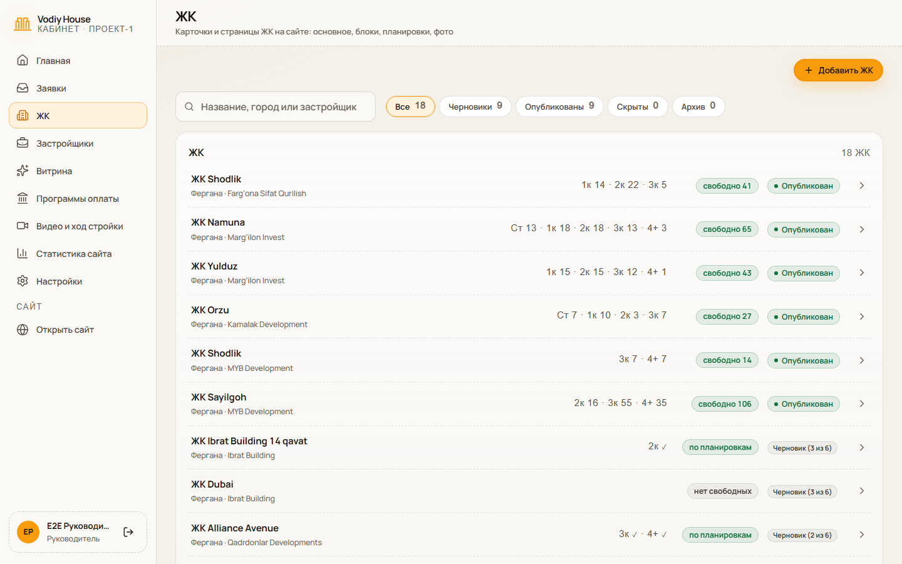
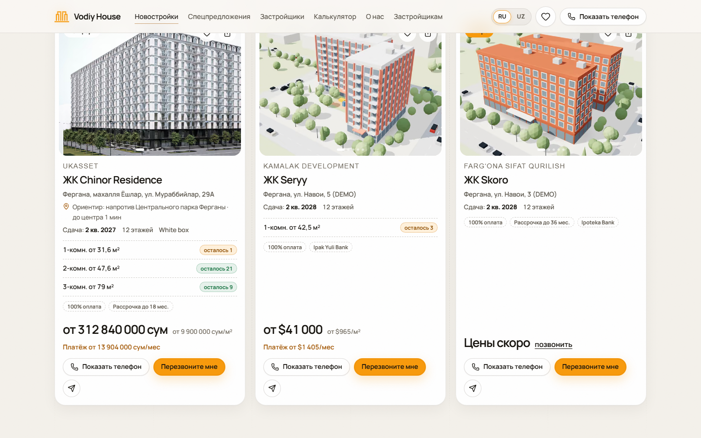
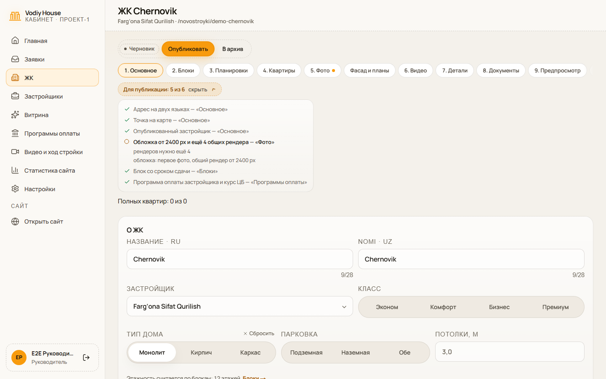
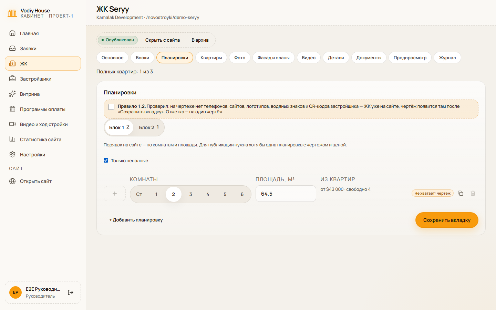
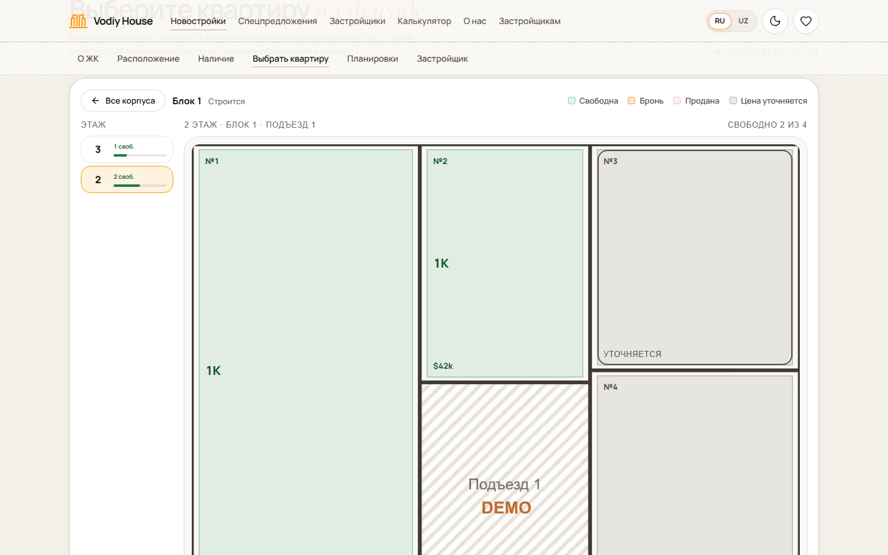

# Памятка руководителя Vodiy House

Кабинет — **vodiyhouse.uz/admin**. Руководитель видит всё, что менеджер (см. `docs/manager-guide.md`), и ещё: **Застройщики, Витрина, Статистика сайта, Настройки**, а в ЖК — все вкладки. Контент сайта (ЖК, застройщики, спецпредложения, подборки) ведёт только руководитель.

**Правило 1.2** — главное: на сайте нет ни одного контакта застройщика. Кабинет не даст сохранить текст с телефоном, сайтом, @ником или t.me. Все фото и чертежи ЖК вы подтверждаете галочкой «Проверено по правилу 1.2» в окне публикации. У опубликованного ЖК или застройщика каждую новую загрузку (фото, чертёж, фасад, план, логотип, фото витрины) сначала подтверждаете галочкой «Проверил: …» — она действует на одну загрузку. Вкладку «Видео» сохраняют только с такой галочкой.

## 1. Застройщик и ЖК

**Застройщик** (нужен до ЖК). **Застройщики → «Добавить застройщика»** → название латиницей, как пишет сам застройщик → «Создать черновик». Для публикации нужны текст «О компании» на русском и узбекском и логотип. Вкладка **«Внутреннее»** (контакты застройщика, заметки) на сайт не попадает никогда.

**Новый ЖК.** **ЖК → «Добавить ЖК»** → застройщик, название по-русски и по-узбекски (без слова «ЖК» — сайт добавит сам) → «Создать черновик». Адрес страницы на сайте получится из узбекского названия.

Черновик ведёт по шагам — вкладки с номерами и кнопка «Далее» внизу:

| Вкладка | Что заполнить |
|---|---|
| Основное | класс, тип дома, парковка, потолки, короткое описание, город или район, адрес и ориентир на двух языках, точка на карте, что рядом |
| Блоки | название блока, этажность, строится или сдан, срок сдачи (квартал), готовность %, валюта цен, отделка, что входит в цену |
| Планировки | по блокам: комнаты, площадь, чертёж, «цена от» (до 60 на блок; у блока со списком квартир цена считается из квартир) |
| Квартиры | список квартир блока и наличие (раздел 3) |
| Фото | обложка и ещё минимум 4 общих рендера, всего до 30 фото; у каждого фото — тип (раздел 2) |
| Фасад и планы | для «Выбрать квартиру» на сайте (раздел 4), необязательно |
| Видео | до шести роликов YouTube |
| Детали, Документы | темы из «Настройки → Справочники»; дата проверки документов |
| Предпросмотр | настоящая страница ЖК, как на телефоне, RU и UZ |

Вкладку сохраняет **«Сохранить вкладку»**; фото, фасад и наличие сохраняются сразу.

**Срок сдачи.** Меняете срок у сохранённого блока — по умолчанию это перенос, и на сайте появится «перенесён с …». Исправляете опечатку — снимите галочку «Это перенос срока застройщиком». Ошибочный перенос убирают в «Переносы срока на сайте» → «Убрать из истории».

**Опубликовать.** Вверху видно «Для публикации: N из 6», янтарные точки — на вкладках, где чего-то не хватает. Шесть пунктов: название и адрес на двух языках; точка на карте; опубликованный застройщик; обложка от 2400 px и ещё 4 общих рендера ЖК; блок со сроком сдачи; программа оплаты застройщика и записанный курс ЦБ. Каждый пункт — ссылка туда, где его заполняют. Когда всё есть — **«Опубликовать»** → проверьте все фото и чертежи → галочка правила 1.2 → «Опубликовать на сайте». Нажимаете один раз: дальше ЖК переключается между «Скоро» и полным сам. Для публикации нужен общий номер Vodiy House в «Настройки → Контакты». Застройщик и город ЖК для черновика необязательны.

**Убрать обязательное** у опубликованного ЖК нельзя (последний блок со сроком, нужный рендер, последнюю программу, застройщика, курс): кабинет попросит сначала нажать «Скрыть». Неполные ЖК и квартиры ничего не удаляет: они остаются в кабинете, пока вы их не дозаполните.

**Скрыть** — «Скрыть с сайта»: ЖК пропадёт с сайта, в кабинете останется. Вернуть — «Опубликовать».

**Удалить** — «В архив» → введите название → «Да, в архив». ЖК сразу пропадает с сайта, 30 дней его можно **«Восстановить»** (вернётся черновиком). За 3 дня до окончательного удаления бот пришлёт в Telegram напоминание и CSV со всеми квартирами; через 30 дней ЖК удалится вместе с блоками, квартирами и фото. Застройщика отправляют в архив так же; его ЖК потом восстанавливают по одному. Архив — фильтр «Архив» в списках ЖК и застройщиков.

### Почему ЖК в режиме «Скоро» и как дозаполнить

У ЖК три состояния, в колонке статуса списка «ЖК» они видны сразу:

| Состояние | Что значит | Что видит клиент |
|---|---|---|
| Черновик (N из M) | не хватает пункта минимума или ЖК ещё не опубликован | ничего: ни в каталоге, ни по ссылке, ни в поиске |
| Скоро | минимум есть, полных квартир нет | карточка с меткой «Скоро» в конце каталога, страница без планировок и расчёта, общий номер Vodiy House |
| Опубликован | минимум есть и есть хотя бы одна полная квартира | обычная страница, только полные квартиры |

Как дозаполнить: откройте ЖК, в шапке смотрите «Полных квартир: k из n», затем вкладку «Планировки» с фильтром «Только неполные» — у каждой строки написано, чего не хватает. Заполните, и при первой полной квартире ЖК сам станет обычным; нажимать ничего не нужно. Исчезла последняя цена или чертёж — ЖК сам вернётся в «Скоро».

### Почему квартира не видна на сайте

Квартира полная, когда у планировки есть **чертёж от 1200 px, комнаты и площадь**, а у квартиры этой планировки — **цена**. Рендер интерьера и видео необязательны. В блоке без списка квартир цену и «доступна» задают у самой планировки.

- **Метка «Не хватает: цена · чертёж»** на вкладке «Планировки» — такой планировки нет на сайте нигде: ни в списке, ни в расчёте, ни в фильтрах.

  

- **На плане этажа квартира серая, без цены.** Планировка неполная или у свободной квартиры нет цены. По нажатию клиент видит «Цена уточняется — позвоните в Vodiy House» и общий номер. «Продано» и «бронь» показываются как обычно.

  

- **Блок на фасаде серый с меткой «Скоро»** и не нажимается: в нём нет ни одной полной квартиры.
- **Всё продано.** Планировка с чертежом и ценой остаётся на сайте как «нет в наличии», без цены и расчёта. ЖК при этом не становится «Скоро».
- **Рендер квартиры на вкладке «Фото»** не идёт в минимум ЖК: минимум считает только общие рендеры. Тип выбирают в панели фото: «Общий рендер ЖК», «Рендер квартиры», «Настоящее фото».

## 2. Требования к фото

JPEG, PNG или WebP до 25 МБ; больше 3200 px кабинет уменьшит сам.

| Что | Длинная сторона от |
|---|---|
| Фото ЖК | 1600 px |
| Обложка — первое фото ЖК | 2400 px |
| Фасад, фон застройщика, фото спецпредложения | 2400 px |
| Чертёж планировки, план этажа | 1200 px |
| Логотип застройщика | 400 px |

Порядок — кнопками «Левее» / «Правее», обложка — «Сделать обложкой». Нажмите на главное на фото — кадры для обложки, карточки и телефона подстроятся сами. Фото — рендеры застройщика без водяных знаков чужих сайтов и без контактов застройщика.

## 3. Квартиры и наличие

Вкладка **Квартиры** → выберите блок (этажность задаётся на вкладке «Блоки») → у блока без списка **генератор**: подъезды, первый жилой этаж, квартир на этаже, первый номер → «Создать N квартир». **Стояки** назначают планировку квартирам по позиции на этаже → «Сохранить стояки». Одну квартиру добавляет «+ Квартира».

Цену ставите вы (менеджер не может): отметьте квартиры → **«Цена»** (за м², за квартиру или без цены). Там же «Статус», «Отделка», «Удалить». «Цена от» планировки считается из свободных квартир; у блока без списка — задаётся в планировке. Статусы свободна / бронь / продана меняют и руководитель, и менеджер; на сайте сразу меняется «осталось N шт.».

## 4. Фасад и планы («Выбрать квартиру»)

Вкладка **«Фасад и планы»**: загрузите фасад со всеми блоками (от 2400 px) → выберите блок и щёлкните по углам его силуэта → «Сохранить контур». Затем **«Новый план»**: подъезд или весь этаж, этажи «с … по», картинка плана → обведите каждую квартиру → «Сохранить контуры квартир». Раздел появится на сайте, когда есть фасад, контур блока и хотя бы один план. Нужен список квартир блока. Новый фасад снимает контуры всех блоков, новая картинка плана — контуры его квартир: после замены обведите заново.

## 5. Витрина

**Витрина** — три вкладки: **Спецпредложения**, **Подборки**, **Реклама**.

- **Спецпредложение** — подарок, рассрочка, через банк или старт продаж: бейдж на карточке ЖК, заголовок и текст на двух языках, ЖК, период показа. Видно на главной и бейджем на карточках ЖК. Слово «скидка» и «−N%» кабинет не пропустит.
- **Подборка** — ЖК вручную или по фильтру (комнаты, цена, срок сдачи, город, оплата). Периода нет: включённая подборка видна всегда — рядом карточек над каталогом; нажатие открывает каталог с этой подборкой. Подборка без ЖК на сайте не показывается.
- **Реклама** — карточка на главной: заголовок, текст, куда ведёт «Показать квартиры». Место одно — показывается первая по «Порядку» (меньше — раньше).

**Новая запись создаётся выключенной** — включите «На сайте» и сохраните, иначе на сайте её не будет. Период — «Показывать с … по …» по ташкентским датам, по умолчанию 30 дней. Истёкшее снимается само в полночь; за 3 дня до конца бот напомнит «продлить или снять». Фото добавляется после сохранения записи. **«Удалить» в Витрине удаляет сразу**, без архива.

## 6. Программы оплаты

Карточка программы — переключатель **«На сайте» / «Выключена»**. «Изменить» — ступени взноса, сроки, разовые платежи, кнопки сроков 12/24/36/48, можно ли клиенту ввести свой срок, где действует (блоки). Удалить можно только выключенную; у застройщика всегда остаётся хотя бы одна включённая программа. «Условия проверены сегодня» — отметка после сверки с застройщиком; старше 60 дней — предупреждение.

**Курс ЦБ** — строка «Курс ЦБ: 1 $ = … сум». Сайт ЦБ (cbu.uz) отвечает только из Узбекистана, поэтому кнопка «Обновить курс ЦБ» с сервера сайта обычно не срабатывает («Нет связи с сервером»): курс кладёт исполнитель командой оттуда. Курс устарел — **«Зафиксировать курс»** (от 1 000 до 100 000 сум за $), потом «Вернуть курс ЦБ».

**Пока у сайта нет сервера в Узбекистане, курс ведёте вы вручную** (решение 02.11.2026): раз в неделю и при заметном изменении курса — откройте cbu.uz, нажмите «Зафиксировать курс» и введите курс доллара. Без записанного курса ЖК не опубликовать (условие «Программа оплаты»), а расчёты на сайте в сумах не покажутся. Когда появится сервер в Узбекистане, курс снова будет обновляться сам — тогда нажмите «Вернуть курс ЦБ».

**Отчёты мобилографа о стройке проверяете и публикуете только вы** (с 02.11.2026; менеджер их только видит). «Видео и ход стройки» → «Ждут проверки» → **«Проверить»** → посмотрите фото и видео. Нет телефонов, сайтов, QR-кодов и логотипов застройщика → отметьте **«Проверено по правилу 1.2»** → **«Опубликовать на сайте»**. Есть что исправить → **«Вернуть мобилографу»** и напишите, что именно.

## 7. Статистика сайта

**Статистика сайта** — посетители, визиты, просмотры, заявки, конверсия, «Показали телефон / Telegram» с изменением к прошлому периоду; график; источники; устройства и язык; типы заявок; популярные ЖК и застройщики; рекламные креативы (метка utm_content в ссылке рекламы); путь посетителя. Периоды — «Сегодня», 7 и 30 дней, «Этот месяц» или свой (до 400 дней). **CSV** — цифры периода для Excel. Сотрудники с входом в кабинет и боты не считаются. На Главной — карточка «Сайт сегодня».

Чтобы видеть креативы, ставьте в ссылки рекламы метки: `?utm_source=instagram&utm_medium=reels&utm_content=shodlik_reels_03` (только латиница, цифры, «_», «-» и «.», до 60 знаков — иначе метка не запишется).

## 8. Настройки

- **Сотрудники** → «Добавить сотрудника»: имя, email, роль (руководитель, менеджер, мобилограф) → «Создать и показать пароль». Пароль покажется **один раз** — «Скопировать для Telegram» и отправьте сотруднику; при первом входе он задаст свой. В строке сотрудника — «Отключить» (вход закрывается сразу) и «Новый пароль». Роль сменить и сотрудника удалить нельзя: для новой роли отключите сотрудника и создайте заново с **другим** email (тот же не примется). Отключённого возвращает «Включить». Себя и последнего активного руководителя отключить нельзя.
- **Контакты** — телефон, Telegram, бот, Instagram, «Перезвоним за N минут», часы работы, «Для вас бесплатно». Это все контакты на сайте, кроме адреса офиса (его меняет исполнитель); пустое поле убирает кнопку с сайта.
- **Справочники** — города и районы, типы документов, темы деталей, отделка, банки, подсказки калькулятора. Используемое значение не удаляется, а скрывается.
- **Журнал** — кто, что и когда поменял.

## Если что-то не так

- Сотрудник забыл пароль — «Настройки → Сотрудники → Новый пароль».
- Вы забыли пароль, а другого руководителя нет — к исполнителю (команда восстановления руководителя).
- 10 неверных паролей за 15 минут — вход с этим email с этого устройства (сети) закрыт на 15 минут.
